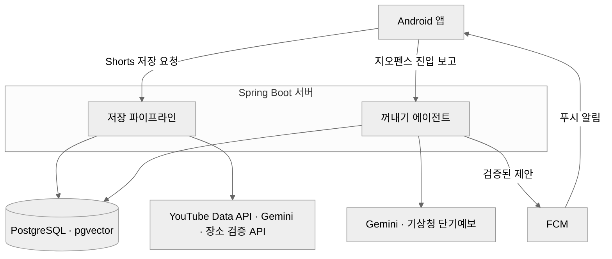
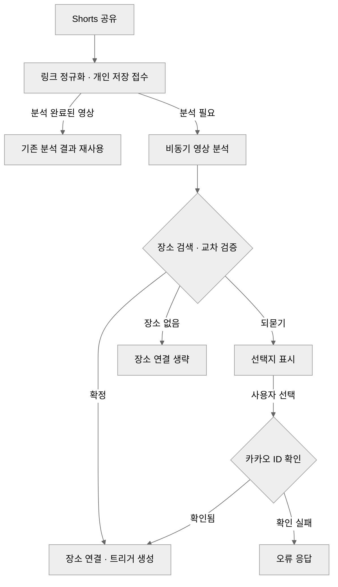
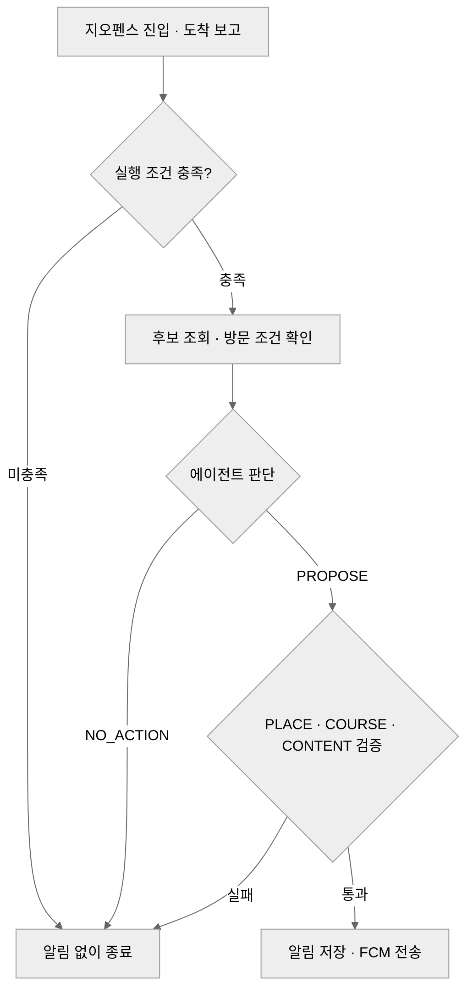
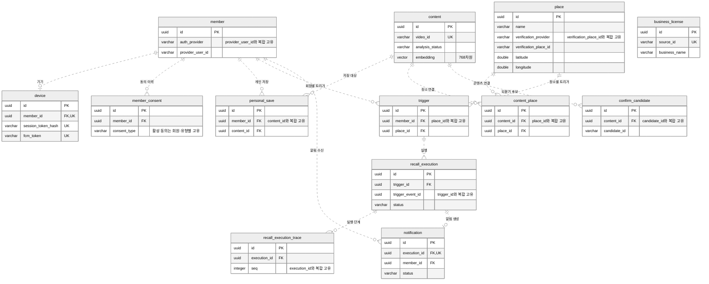

# REMEMBRALL 테크스펙

<aside>
💡

1. 노란색을 제외한 요소들은 선택사항입니다.
2. 핵심요소라고 해서 무조건 작성하는 것은 아닙니다.
3. 다른 요소를 추가하셔도 됩니다.
</aside>

# <u>배경</u>

<aside>
💡

왜 이 기능을 만드는지, 어떤 사용자 문제를 해결하려 하는지 등

</aside>

대학생은 Shorts에서 본 맛집이나 여행지를 일단 저장한다. 막상 그 동네에 갔을 때는 저장했다는 사실을 잊고, 결국 다시 검색한다. REMEMBRALL은 영상에서 실제 장소를 찾아두고 사용자가 그 근처에 갔을 때 다시 꺼내 준다.

# <u>목표</u>

<aside>
💡

예상 가능한 결과들

</aside>

- YouTube Shorts를 공유하면 제목·요약·카테고리와 검증된 장소가 저장된다. 장소가 모호하면 후보를 보여 주고 선택을 받는다.
- 저장한 장소의 지오펜스에 진입하면 방문 조건을 판단한다. 알릴 만하면 푸시를 보낸다. 사용자가 알림을 열면 제안 유형에 맞는 저장 화면으로 이동한다.
- 위치 동의가 없거나 실행 조건을 충족하지 않으면 알림을 보내지 않는다. 최근 발송에 성공한 장소·콘텐츠는 중복 제안에서 제외한다.

# <u>일정</u>

<aside>
💡

프로젝트 시작부터, 기획, 디자인, 개발, QA, 릴리즈 일정 등 모든 일정

</aside>

기존 팀 테크스펙의 월별 계획과 최종 MVP 반영 범위다.

| 구분 | 시점 | 마일스톤 | 세부 내용 |
| --- | --- | --- | --- |
| 기획 | 아이디어톤 (1단계) | 문제 정의와 PRD 초안 | 저장한 맛집·여행지를 실제 방문 시점에 다시 찾기 어려운 문제를 정의했다. |
| 개발 | 9월 | 공유 → 저장 파이프라인 | YouTube Shorts 공유, 메타데이터 수집, 영상 요약·분류, 장소 검증과 비동기 저장으로 구현했다. |
| 개발 | 10월 | 꺼내기와 트리거 | Android 위치 진입, 방문 조건 확인, 제안 또는 침묵, FCM 알림을 구현했다. 일정 트리거는 MVP에서 제외했다. |
| 개발·QA | 11월 | 외부 연동·QA·데모 | 지도·장소 데이터·날씨 연동, 에이전트 평가, Android APK와 랜딩을 정리했다. |

# <u>담당</u>

<aside>
💡

프로젝트를 담당하고 있는 모든 인원

</aside>

### 담당

| 이름 | 역할 (5-2) | 조 배정 |
| --- | --- | --- |
| 남준혁 | PM | 검색·트리거조 |
| 서민규 | 백엔드 리더 | 검색·트리거조 (+ 전 조 인터페이스 조율) |
| 김종훈 | 평가·QA, AI 리더 | 수집·처리조 |
| 김에스더 | 평가·QA | 수집·처리조 |
| 김동희 | 프론트 엔드 리더 | 앱·경험조 |
| 박정현 | 통합 및 백엔드 | 앱·경험조 |

### 조 구성

| 조 | 담당 업무 | 인원 |
| --- | --- | --- |
| 수집·처리조 | 영상 메타데이터 수집, 요약·분류, 장소 추출과 검증 | 김종훈, 김에스더 |
| 검색·트리거조 | 위치 트리거, 후보·유사도 검색, 꺼내기 판단, 지도 API | 남준혁, 서민규 |
| 앱·경험조 | Android 화면, 공유 수신, 되묻기와 상세 흐름, 시연 빌드 | 김동희, 박정현 |

# <u>요구사항</u>

<aside>
💡

기능적, 비기능적 요구사항으로 나누어 생각

</aside>

## 기능

| 영역 | MVP 동작 |
| --- | --- |
| 저장 | Android 공유 시트에서 Shorts 링크를 받고, 영상 분석과 장소 검색 결과를 저장 목록에 보여 준다. |
| 장소 검증 | 좌표와 실제 장소를 교차 검증한다. 되묻기 후보는 카카오로 사전 검증한다. 일시적인 호출 오류가 난 후보는 남겨 두고, 사용자가 고르면 다시 검증한다. |
| 꺼내기 | 저장한 장소에 진입하면 후보를 모으고 방문 조건을 확인한다. `PROPOSE` 또는 `NO_ACTION`으로 판단한다. |
| 알림 | 서버 검증을 통과한 제안만 FCM으로 전송한다. 알림을 열면 첫 번째 항목에 해당하는 저장 화면으로 이동한다. |

## 비기능

- **응답성과 중복 방지** — 저장 접수와 영상 분석을 분리한다. 동일 영상은 분석 결과를 공유하고, 도착 보고를 다시 보낼 때는 같은 이벤트 ID를 쓴다.
- **알림 빈도** — 회원 단위 실행 간격은 기본 2시간이다. 최근 7일 이내 발송 성공(`SENT`) 이력을 기준으로 중복을 제외한다. 장소 제안은 회원·장소, 장소 없는 제안은 회원·콘텐츠 단위다.
- **위치와 개인정보** — 앱은 OS 위치 권한과 위치기반서비스 동의를 따로 받는다. 현재 좌표는 지오펜스 목록 조회에 쓰고, 앱의 도착 보고에는 좌표를 싣지 않는다. 영상·음성·전체 자막의 원본은 보관하지 않는다.
- **인증과 데이터 접근** — 서버는 불투명 Bearer 세션 토큰의 SHA-256 해시만 DB에 저장한다. 앱은 설치 ID와 세션을 SecureStore에 둔다. 공용 후보는 유효한 기여 동의가 있는 저장만 사용한다. 현재 앱에는 이 동의 화면이 없다.

# <u>아키텍처 설계</u>

<aside>
💡

전체적인 구조와 흐름 등을 도식화

</aside>

| 구성 | 기술과 역할 |
| --- | --- |
| 앱 | Android · Expo · React Native · TypeScript. 공유 수신, 저장 목록·지도·상세, OS 지오펜스 등록, FCM 알림 처리 |
| 서버 | Java 21 · Spring Boot · Spring AI. 인증·동의, 저장 파이프라인, 꺼내기 판단 및 검증, FCM 전송 |
| DB | PostgreSQL · pgvector · Flyway. 회원·저장·장소·트리거·실행·알림과 768차원 요약 임베딩 |
| 외부 연동 | YouTube Data API와 Gemini로 영상 분석, VWorld·LocationIQ·TourAPI·공공 상가 정보 데이터와 카카오 로컬로 장소 검증, 기상청 단기 예보로 방문 조건 확인 |

꺼내기 에이전트는 Spring Boot 서버 안의 `recall` 모듈에서 실행된다. 앱은 REST로 요청하고, 꺼내기 결과는 FCM으로 받는다.

## 시스템 구성도



## 저장 흐름



1. 앱이 Shorts 주소를 정규화해 저장을 요청한다. 서버는 `videoId`로 콘텐츠를 재사용하고 회원의 개인 저장을 연결한다. 영상 분석은 커밋 뒤 별도 실행기에서 처리한다. 기본 동시 실행 수는 2개다.
2. YouTube에서 제목·설명·태그·게시일·채널 작성자 댓글을 모은다. Gemini는 영상과 메타데이터에서 요약·카테고리·상호·지점·지역·기간 정보를 구조화한다. 좌표는 장소 검색 단계에서 찾는다.
3. 지점명이 있으면 VWorld·LocationIQ로 기준점을 찾고 주변의 상가·인허가 데이터를 대조한다. 지점명이 없으면 TourAPI와 공공 상가 정보 데이터를 먼저 보고, 필요하면 LocationIQ 검색 결과를 거른다.
4. 후보 1곳은 검증 뒤 확정한다. 지점이나 업소명이 맞지 않거나 2~3곳으로 좁혀지면 되묻기 후보가 될 수 있다. 0곳 또는 4곳 이상은 장소 없음으로 처리한다. 확정 장소와 되묻기 선택지는 카카오 장소 ID로 사전 검증한다. 되묻기 후보에서 조회 결과가 없으면 제외하고, 호출 오류가 나면 후보를 남겨 사용자가 고를 때 재검증한다.
5. 제목·요약·카테고리를 `gemini-embedding-001`로 임베딩한다. 확정 장소가 있으면 콘텐츠에 연결하고 회원별 장소 트리거를 만든다.

## 꺼내기 흐름



1. 로그인, 위치 권한 ‘항상 허용’, 위치 이용 동의가 모두 있으면 앱이 목록을 받는다. Android 한도 100개 중 최대 99개를 가까운 장소에 쓰고 1개를 목록 재조회에 쓴다. 장소 반경은 기본 150m다. 최근 7일 이내 발송에 성공한 알림의 장소는 등록 목록에서도 제외한다.
2. 장소 지오펜스의 `ENTER`에서 도착을 보고한다. 재조회 지오펜스에서 나가면 목록을 갱신한다. 정상 응답(202)을 받으면 대기열에서 제거한다. 타임아웃·통신 실패·5xx 등으로 대기열에 남은 보고는 같은 `triggerEventId`로 다시 보내고, 30분이 지나면 버린다.
3. 서버는 동의, 회원·장소 트리거, 이벤트 나이, 중복, 실행 간격과 해당 장소의 최근 발송 성공 이력을 확인한다. 같은 이벤트를 다시 받았을 때 이전 실행이 실패하거나 시간 초과된 경우에만 기본 1회 재실행할 수 있다.
4. 기본 반경 1km의 후보와 의미 유사 후보를 모은다. 장소를 제안할 때 에이전트는 `checkVisitConditions`로 운영 조건·최근 알림·날씨를 확인하고, 필요하면 `searchCandidates`로 대안을 찾는다. 도구 호출은 기본 최대 6회, 에이전트 실행 제한은 기본 90초다.
5. `PROPOSE`에는 `PLACE` 한 장소, `COURSE` 서로 다른 여러 장소, `CONTENT` 장소 참조 없는 콘텐츠 한 건이 있다. `COURSE`는 프롬프트에서 두세 곳을 고르도록 하고, 서버는 최소 2곳과 도착 지점부터의 추정 도보 시간 30분 이내를 검증한다.
6. 서버 검증을 통과하면 알림을 저장하고 FCM으로 발송한다. `NO_ACTION`이면 발송 없이 끝낸다. 앱은 알림의 첫 번째 항목만 열며, `COURSE`는 첫 장소 상세, 장소 없는 저장물은 저장 결과 화면으로 이동한다. 첫 항목에 내 저장 ID가 없으면 찾을 수 없음 화면을 표시한다. 서버는 정상 도착 보고를 처리한 뒤 `202`를 반환한다.

### 초기 설계 참고

# <u>데이터 모델</u>

<aside>
💡

필요한 DB구조, 필드 정의 등

</aside>



# <u>인터페이스 명세</u>

<aside>
💡

요청/응답 구조, 프론트 개발자들이 필요한 예시가 포함 된 스펙

</aside>

[API 명세서 (2)](https://app.notion.com/p/API-2-96a57ec5075982d0b8a5819d74cda24e?pvs=21)

로그인 뒤 요청은 `Authorization: Bearer {sessionToken}` 헤더를 사용한다. 아래는 앱의 핵심 흐름 기준이다.

| API | 요청 | 응답 |
| --- | --- | --- |
| `POST /api/auth/guest` | `installationId` | `200`, 세션 토큰·만료 시각 |
| `GET /api/me/consents` | — | `200`, 동의 상태 목록 |
| `PUT /api/me/consents/{consentType}` | `agreed`, `termsVersion` | `200`, 변경된 동의 상태 |
| `PUT /api/devices/fcm-token` | `fcmToken` | `204` |
| `POST /api/personal-saves` | `url` | 신규 `201` / 기존 `200`, 저장 ID·콘텐츠 ID·분석 상태·저장 시각 |
| `GET /api/personal-saves` | `size`, `cursor` | `200`, `items`·`nextCursor` |
| `GET /api/personal-saves/{personalSaveId}` | 저장 ID | `200`, 상세·`places`·`confirmCandidates` |
| `DELETE /api/personal-saves/{personalSaveId}` | 저장 ID | `204`, 개인 저장 삭제 |
| `GET /api/personal-saves/places` | — | `200`, 지도용 저장 장소 목록 |
| `POST /api/personal-saves/{personalSaveId}/places/{candidateId}/confirm` | `selectedOptionId` | `204`. 잘못된 선택지 `400`, 후보 없음 `404`, 장소 검증 불가 `422`, 카카오 호출 오류 `502 KAKAO_API_ERROR` |
| `GET /api/geofences` | `latitude`, `longitude`, `platform` | `200`, `regions`·`resync`·`places` |
| `POST /api/location-events` | `placeId`, `triggerEventId`, `eventType`, `eventOccurredAt` | 정상 요청은 처리 결과에 관계없이 `202`, 본문 없음 |
| `GET /api/notifications/{notificationId}` | 알림 ID | `200`, 알림 상세 |
| `POST /api/notifications/{notificationId}/open` | 알림 ID | `204`, 최초 열람 시각 기록 |

저장 요청 예시 (`POST /api/personal-saves`)

```json
{
  "url": "https://www.youtube.com/shorts/AbCdEfGhI12"
}
```

`202`는 도착 보고의 HTTP 응답이다. 실제 알림 여부는 꺼내기 판단과 서버 검증에 따라 정해진다. 위 표는 앱이 사용하는 경로를 요약한다. 카카오 로그인과 로그아웃 등 서버가 제공하는 경로와 상세 계약은 위 하위 명세에 있다.

# <u>리스크</u>

<aside>
💡

개발뿐 아니라 프로젝트 전체에서 예상되는 리스크와 대응 방안

</aside>

| 리스크 | 현재 대응과 남은 한계 |
| --- | --- |
| 다른 지점으로 잘못 저장 | 공공 업소·인허가 데이터로 교차 확인하고 카카오 장소 ID를 검증한다. 모호하면 되묻거나 장소 없이 저장한다. |
| 영상 분석 지연과 외부 API 장애 | 분석을 요청 처리에서 분리하고 동시 실행 수를 제한한다. 대기열은 서버 메모리에 있고, 회원별 저장·요청 제한은 아직 없다. |
| 통학길이나 이동 중 과도한 알림 | 회원별 2시간 실행 간격과 최근 7일 발송 성공 이력을 기준으로 중복을 제외한다. `ENTER`는 지나가는 경우에도 발생할 수 있다. |
| 오래됐거나 불확실한 방문 정보 | 저장 요약의 운영 기간·휴무, 최근 제안 이력, 날씨를 확인한다. 실시간 폐업 여부까지 보장할 수 없다. |
| 배포 중 장애 | 기존 DB를 백업하고 새 컨테이너의 내·외부 health를 확인한다. 실패 시 이전 이미지로 되돌린다. 교체 중에는 짧은 점검 시간이 있다. |

# <u>요청사항</u>

<aside>
💡

각 담당자들에게 질문과 요청 / 결정사항 등을 정리하고 공유

</aside>

초기 논의에서 지원 플랫폼은 YouTube Shorts로, 트리거는 회원별 장소 지오펜스로 확정했다. 저장 중 장소가 애매하면 선택지를 되묻고, 방문을 권할 근거가 약하면 `NO_ACTION`으로 끝낸다.

| 요청 대상 | 요청 내용 | 이유 |
| --- | --- | --- |
| 앱·정책 | 약관·정책 페이지 연결과 공용 후보 기여 동의 화면 검토 | 현재 앱에서는 공용 후보 기여 동의를 받을 수 없다. |
| 앱 | 장소 직접 찾기를 저장에 연결하고, 여러 장소를 상세에서 넘겨 볼 수 있게 한다. | 저장물 한 건에 여러 장소가 연결될 수 있지만 상세는 한 장소만 보여 준다. |
| 서버·운영 | 회원당 저장 수·요청 빈도 제한을 검토한다. | 영상 분석과 외부 API 호출 부하를 제한할 기준이 필요하다. |
| 앱·QA | 단순 통과 때의 실행과 알림을 Android 기기에서 확인한다. | `ENTER`가 도착 의도와 관계없이 발생해 쿨다운을 소모할 수 있다. |
| 앱·인증 | 카카오 로그인 옵션을 켤 시점과 검증 범위를 정한다. | 서버에 연동은 있으나 앱에서는 옵션이 꺼져 있다. |

# <u>시나리오</u>

<aside>
💡

사용자 관점에서의 흐름이나 주요 동작

</aside>

### 1. 저장하는 순간

사용자가 ‘대전 원도심 카페’ Shorts를 보고 공유 시트에서 REMEMBRALL을 선택한다. 분석이 끝나면 저장 목록에서 영상 요약과 검증된 장소를 볼 수 있다.

### 2. 잊어버리는 기간

저장한 장소에 진입하기 전까지는 해당 저장물의 위치 알림이 오지 않는다. 썸네일은 저장 기간에 따라 바랜다. 덮개 불투명도는 7일 미만 0%, 7일 이상 30일 미만 30%, 30일 이상 50%다.

### 3. 꺼내지는 순간 (핵심 장면)

몇 주 뒤 사용자가 저장한 카페 근처에 간다. 위치 동의와 실행 조건이 맞으면 에이전트가 방문 조건을 확인한다. 카페 한 곳을 제안하면 FCM 알림이 오고, 탭하면 해당 장소의 저장물 상세가 열린다. 근처에서 연 상세의 썸네일은 600ms 동안 원래 색으로 돌아온다.

### 4. 아무 일도 일어나지 않는 경우

통학길에 같은 카페 앞을 다시 지난다. 최근 7일 안에 그 장소의 알림이 발송됐거나 회원 단위 쿨다운에 걸리면 새 알림이 오지 않는다.

### 5. 물어보는 경우

Shorts에서 카페 지점을 하나로 좁히기 어렵다. 앱은 후보를 보여 주고, 카카오 ID가 확인된 장소를 저장물에 연결한다. 사전 검증 호출이 실패했던 후보는 선택 시 서버가 다시 확인한다.

### 6. 저장물이 없는 경우

근처에 회원의 저장 장소가 없으면 해당 장소의 진입 트리거가 발생하지 않는다.

### 7. 정보가 낡은 경우

저장한 전시의 운영 기간이 지났거나 휴무 정보가 있으면 에이전트가 그 근거를 방문 판단에 반영한다. 실시간 폐업 여부까지 확인하는 흐름은 구현 범위에 없다.

# <u>트레이드오프</u>

<aside>
💡

기술이나 구현/기획에 있어서 고민했던 내용

</aside>

| 결정 | 선택 이유와 비용 |
| --- | --- |
| 저장 에이전트 구상 → 규칙 기반 저장 파이프라인 | 장소 검색과 재검증의 순서를 고정해 실패 원인을 추적하기 쉽다. 영상 이해에는 Gemini를 쓴다. |
| 동기 저장 → 비동기 분석 | 초기 실측에서 분석에 24~189초가 걸렸다. 앱에 먼저 응답할 수 있지만, 서버는 진행 상태와 실패 재처리를 관리해야 한다. |
| LocationIQ 단독 → 공공 데이터 대조와 카카오 ID 검증 | 장소 정보 부족이라는 한계 해결이라는 장점이 있다. 다만, 검색 결과가 1건이어도 다른 지점일 수 있었다. 호출 단계는 늘었지만 오확정과 답변 시점의 검증 실패를 줄이는 방향이다. |
| 지역·장소 2단계 등록 → 가까운 장소와 재조회 지오펜스 | OS 슬롯을 장소에 더 쓰고 등록을 단순화한다. 재조회 영역을 벗어나면 다시 등록해야 한다. |
| Android `DWELL` → `ENTER` | 30초 체류가 지나가는 경우를 충분히 거르지 못하고 네이티브 모듈 비용이 컸다. 단순 통과도 들어오는 대신 실행 간격과 최근 제안 제한을 적용한다. |
| 도착 보고 동기 처리 | 서버가 실행을 끝낸 뒤 응답한다. 앱은 10초 타임아웃 등으로 정상 응답을 받지 못하면 동일 ID를 대기열에 남긴다. 서버는 같은 이벤트의 중복 실행을 막는다. |
| PostGIS → 하버사인 계산 | MVP 데이터 규모에서는 SQL·Java 계산으로 충분하다고 판단했다. 별도 공간 인덱스의 이점은 추후 규모가 커질 때 검토한다. |
| JWT+리프레시 토큰 → DB 세션 | 한 서버·회원당 한 기기 조건에서 로그아웃과 기기 교체를 다음 요청부터 반영한다. 인증마다 DB 세션을 확인한다. |
| 꺼내기 v4 도구 | 첫 입력에 없는 날씨·휴무·최근 제안 정보를 확인해 판단을 바꿀 수 있다. v3 도구 OFF보다 토큰 사용량이 늘고, 대안 검색 호출률에는 개선 여지가 남는다. |

# <u>테스트 전략</u>

<aside>
💡

유닛/통합/QA 등 방식을 정하고 테스트에 필요한 환경도 구성

</aside>

- **백엔드 CI** — 빌드, JUnit, Bruno 기본 회귀, 합성 데이터 기반 Bruno 회귀, 배포 도구 검사로 나눈다. CI는 실제 키 대신 테스트 값을 쓰고 꺼내기 에이전트는 stub으로 돌린다.
- **연동·기기 QA** — 실제 외부 API는 배포 전 일회용 DB로 확인한다. 앱은 lint·포맷 검사와 Android의 공유·백그라운드 위치·FCM·알림 열기 흐름을 QA 대상으로 둔다.
- **에이전트 평가** — 골든셋을 격리된 PostgreSQL에 넣고 실제 후보 준비·임베딩·에이전트 모델로 실행한다. 별도 Judge가 후보 ID, 장소 연결, 근거, 방문 조건 등 기준으로 `GOOD`·`ACCEPTABLE`·`BAD`를 판정한다. 에이전트·채점 실패는 품질 점수와 별도로 센다. 날씨는 장면별 고정값을 사용했다.

| 평가 | 결과 |
| --- | --- |
| 회귀 tune v4, 72건 | BAD 0건, 에이전트 실패 1건, GOOD 48건, ACCEPTABLE 23건. 중앙값 8.61초, p95 11.25초, 실행당 6,513토큰 |
| 회귀 holdout v4, 6건 | 6건 모두 GOOD |
| 도구 세트 v4, 54건 | BAD·에이전트 실패 0건. 확인 호출 42/42, 필요할 때 대안 검색 3/9, 불필요 호출 8/9. 조건만 바꾼 6쌍 중 5쌍에서 판단이 갈렸다. |
| 저장 영상 분석 1차 | 영상 10개에서 장소 59건 추출. 평가셋에서 상호·지점이 모두 일치했다. 첫 시도 8/10, 나머지 2개는 재시도로 성공했다. |
| 저장 영상 분석 2차 | 장소 10개가 들어가 있는 Shorts 10번 테스트. Gemini 데이터 추출의 불안정성, API의 오류 등으로 인해 테스트 돌릴 때마다 결과값이 다르게 나오기도 했다. 평균적으로 6/10, 1개는 콘텐츠 자체의 장소 정보 표기 오류, 나머지 3개는 되묻기와 장소 없음이라는 결과를 반복적으로 보여줬다. |

tune의 실패 1건은 JSON을 감싼 백틱 파싱 문제였다. 응답 파싱 보강 뒤 후속 실행에서 같은 실패는 관찰되지 않았다.

# <u>릴리즈</u>

<aside>
💡

릴리즈에 필요한 내용 정리 / 일정과 합쳐도 무방

</aside>

- **Android** - GitHub Release `v1.0.0`의 `remembrall.apk`는 실서버에 연결하는 EAS `preview` 빌드다. `preview-mock`은 서버와 FCM 연결 없이 시연하는 백업 빌드다.
- **서버** - `main` 반영 시 CI와 실제 외부 API 검사를 거쳐 ARM64 이미지를 GHCR에 게시한다. 운영 배포기가 `deploy-main` 채널을 확인하고, 작업이 진행 중이면 교체를 미룬다. 교체 시 DB 백업과 health 확인을 하고 실패하면 이전 버전으로 복구한다. 채널 갱신과 서버 배포기가 모두 활성화되어야 운영에 반영된다.
- **랜딩** - Cloudflare Pages에서 랜딩 저장소 `main`의 `landing/`을 빌드한다. 기술 문서 본문은 저장소의 Markdown에서 관리한다.

# <u>스펙 아웃</u>

<aside>
💡

이번 기획에 포함 되었지만 어떠한 이유로 스펙아웃 된 내용 정리

</aside>

- Instagram Reels(정책 상의 문제), 일정 기반 트리거와 캘린더 연동, iOS 빌드는 Android MVP 범위에서 제외했다.
- 저장 이력을 활용한 새 장소 추천과 장소 사업자 제휴 광고는 발표용 컨셉이다.
- 카카오 로그인은 서버에 구현되어 있지만 앱에서는 꺼져 있다. 장소 직접 찾기는 ‘장소 직접 붙이기’와 ‘이 장소가 아니에요’에서 열 수 있다. 현재 검색 결과는 목 데이터이며, 저장·변경의 서버 연동과 다중 장소 상세 전환은 후속 범위다.

# <u>히스토리</u>

<aside>
💡

기획/디자인/개발 하면서 검색하고 참고했던 자료

</aside>

| 단계 | 참고 자료 |
| --- | --- |
| 초기 설계 | 팀 Notion 초안에서 저장·꺼내기 에이전트, 위치·일정 트리거, PostGIS 데이터 모델을 검토 |
| 구현 결정 | 저장 파이프라인, 장소 교차 검증, 지오펜스, DB 세션, Spring AI 적용을 ADR과 구현 기록에 정리 |
| 평가와 릴리즈 | 꺼내기 v1~v4 비교 및 Android `v1.0.0` 릴리즈 |
| 최종 문서 | 팀 Notion의 목차에 맞춰 구현·평가·배포를 정리하고 초기 계획은 일정 및 설계 변경에 구분 |

# <u>추가 지표</u>

<aside>
💡

프로젝트에서 수집해야 될 값들

</aside>

| 영역 | 지표 | 확인 범위 |
| --- | --- | --- |
| 저장 품질 | 첫 시도 성공률, 재시도 성공률, 장소 일치율, 되묻기 응답률 | 첫 시도·재시도와 장소 일치 결과는 영상 평가셋에서 확인. 되묻기 응답률은 운영 집계 후보 |
| 꺼내기 품질·비용 | BAD·실행 실패율, 확인·대안 검색 호출률, 실행 시간 중앙값·p95, 실행당 토큰 | 골든셋 결과는 테스트 전략의 평가표 참조 |
| 알림 반응 | 발송 대비 최초 열람률, 같은 장소 반복 제안, 통과 이벤트로 인한 실행·쿨다운 소모 | 발송 상태와 최초 열람 시각을 저장한다. 운영 집계는 후속 확인 항목 |